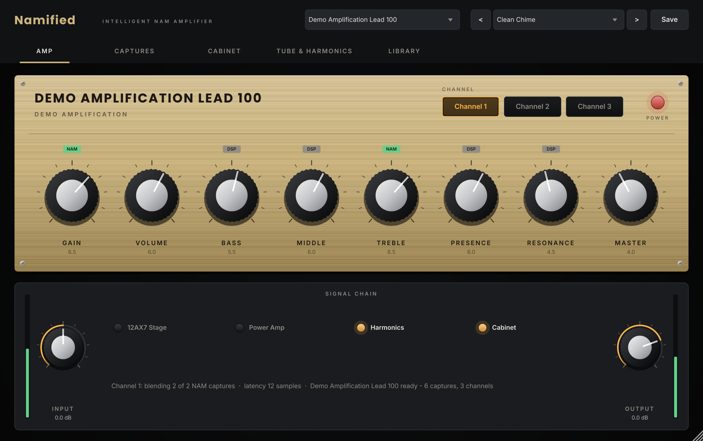
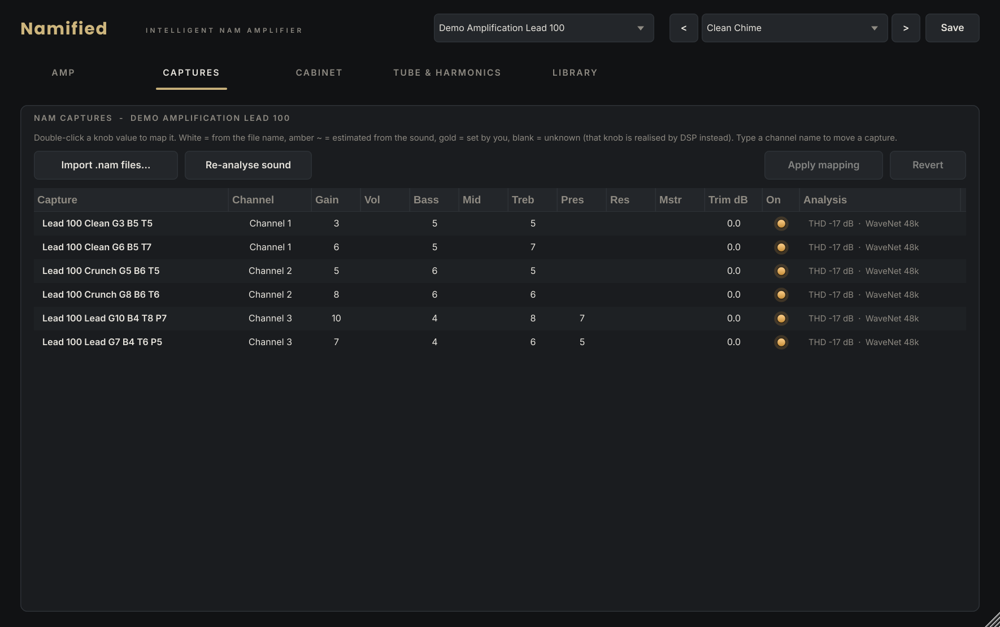
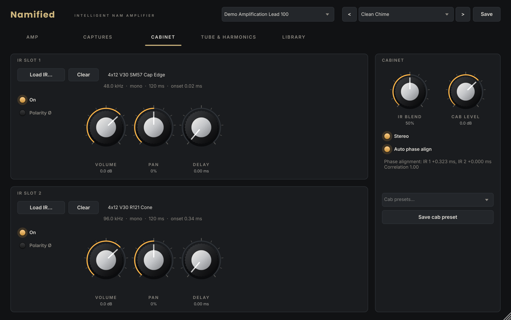
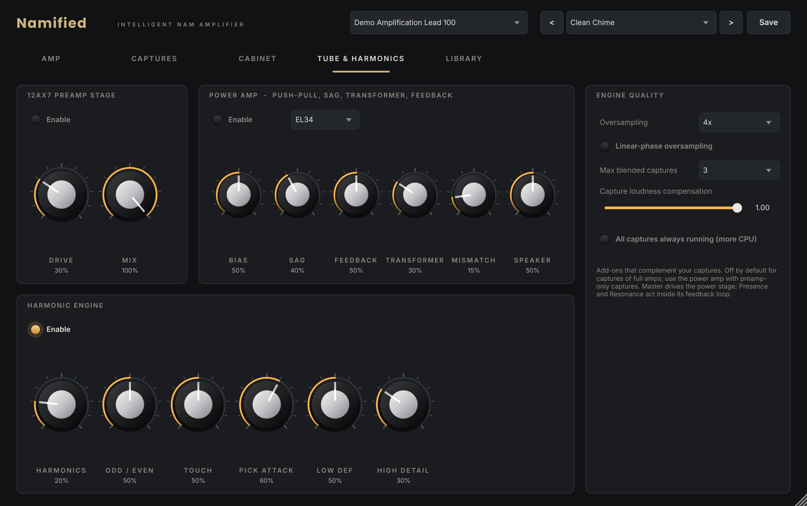
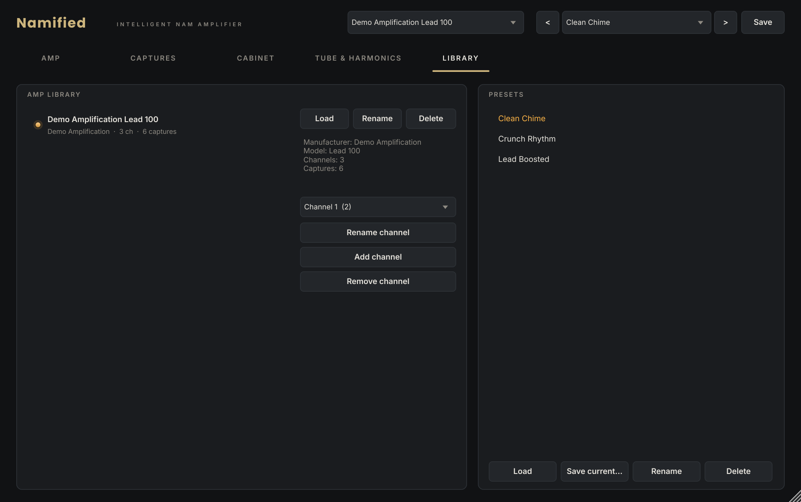

# Namified — Intelligent NAM Amplifier

Namified turns a folder of [Neural Amp Modeler](https://www.neuralampmodeler.com/) captures of **one physical amplifier** into **one playable virtual amplifier** — with real Gain, Volume, Bass, Middle, Treble, Presence, Resonance and Master knobs, real channels, a 12AX7 / power-amp circuit engine, a harmonic engine and a professional dual-IR cabinet.

Standalone app (macOS / Windows) · VST3 (macOS / Windows) · AU (macOS) · C++20 / JUCE 8 · official NAM inference core



## What it does

1. **Drop captures** (files or whole folders) anywhere on the window.
2. Namified reads every capture's NAM metadata, **groups captures by manufacturer + model** (unrelated amps are never merged; captures with no identity wait for you to name them), finds **channels** from names like `ch2`, `Lead`, `Crunch`, and reads **knob settings** from names like `G7 B4 M6 T8 P5` or `gain=65`.
3. Each capture is **analysed by listening to it** (latency, polarity, loudness, compression, harmonic content, tonal balance). Where names don't reveal settings but captures clearly differ, settings are **estimated from the sound** (marked `~` so you can confirm or change them).
4. The amp is saved to your **library** and the interface is generated for it — its name, its channels, its eight controls.

### Knobs that move between captures
Every channel is a point cloud in an 8-dimensional knob space. Turning a knob runs **multidimensional interpolation**: truncated Shepard weights over the controls your captures actually vary, so the closest captures are blended continuously (no jumps when the active set changes, exactly one capture when the knobs sit on its settings). Captures are **run in parallel and blended at their outputs**, so each keeps its own dynamics, with:
- **loudness compensation** (NAM loudness metadata, or measured),
- **phase-aware blending** (latency alignment + polarity matching from the analysis),
- **smooth, sum-preserving glides** and a hold-time so captures never "wake up cold".

Controls no capture varies — or knob positions beyond what you captured — are realised by amp-voiced DSP. The faceplate shows which is which (`NAM` / `DSP` badge).

### Tube circuit engine (complements the captures, never replaces them)
- **12AX7 stage** solved from the Koren triode equations on a real load line (100 k plate, 1.5 k / 22 µF cathode), with grid conduction through the grid stopper, coupling-cap blocking and cathode bias drift.
- **Push-pull power amp** (EL34 / 6L6 Koren pentode models): class-AB bias & crossover, pair mismatch (even harmonics), supply **sag**, plate knee tracking the sagging supply, **output-transformer** flux saturation, global **negative feedback** with Presence/Resonance inside the loop, and **speaker-impedance interaction**.
- **Harmonic engine**: envelope-normalised Chebyshev harmonic generation (adds harmonics without stealing the fundamental), even/odd balance, touch sensitivity, pick-attack preservation, low-end definition, high-frequency detail.
- All non-NAM nonlinearities run **2×/4×/8× oversampled** (low-latency IIR or linear-phase FIR). Measured alias products: **−103 dB** at 4× on a 4.7 kHz sine driven hard.

### Dual IR cabinet
Two independent slots (WAV/AIFF, mono or stereo, 44.1–192 kHz, any length): volume, pan, polarity, delay, on/off · blend · cab level · mono/stereo · **automatic phase alignment** by cross-correlation · cab presets.

### Engine
64-bit processing to the cabinet · sinc resampling (>100 dB stopband) when the host rate differs from the capture's training rate · denormal protection · smoothed automation · click-free channel, amp and preset changes · fixed, reported latency · up to 192 kHz.

## Screens

| Captures (profile manager) | Cabinet |
|---|---|
|  |  |
| **Tube & Harmonics** | **Library & presets** |
|  |  |

## Build

```bash
# macOS (universal), produces dist/Namified-macOS.dmg
BuildScripts/build_macos.sh
# Windows (Visual Studio 2022)
powershell -ExecutionPolicy Bypass -File BuildScripts\build_windows.ps1
# Linux (dev/CI)
BuildScripts/build_linux.sh
```
CMake fetches pinned JUCE, NeuralAmpModelerCore and Eigen. Every push builds macOS, Windows and Linux in GitHub Actions, runs the test suite and uploads the DMG / Windows zip as artifacts. See [Documentation/INSTALL.md](Documentation/INSTALL.md) and [Documentation/ARCHITECTURE.md](Documentation/ARCHITECTURE.md).

## Tests
`Tests/` holds 20 automated tests (538 checks): metadata & knob-token parsing, identity grouping, channel building, interpolation continuity and exactness, NAM inference at 44.1/48/96 kHz, resampler accuracy, capture analysis, 12AX7 bias point & compression, push-pull harmonic cancellation & sag, harmonic engine level-matching, aliasing, IR identity/polarity/delay/alignment/sample-rate loudness, end-to-end "every knob changes the sound", click-free switching, preset round-trips.

## Licenses
See [Documentation/LICENSES.md](Documentation/LICENSES.md) — including the JUCE licensing choice you must make before distributing binaries.
